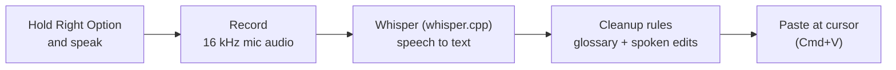

# Voice Prompt

Hold a key, speak English, release. Your words are pasted wherever the cursor is: Claude, a terminal, a chat box. It runs **fully offline** on your Mac, fixes the tech terms speech-to-text gets wrong (`cube control` becomes `kubectl`), and lets you edit by voice ("scratch that").

macOS dictation stopped working when Wi-Fi was turned off on the author's Mac, and neither it nor plain Whisper knows words like `kubectl`, `ArgoCD` or `HAProxy`.

## How it works



There is deliberately no AI rewrite step. Whisper already adds punctuation and drops most "um"s, and on real dictations a rewriting model lost content (once 27 words became 4). Plain find-and-replace rules fix tool names but cannot delete a sentence.

Typical wait after you release the key: about **2 s** (median of 15 real dictations, M1 MacBook Pro; run `src/stats.py` for yours).

## Controls

| Action | Result |
|---|---|
| Hold **Right Option**, release | Record, transcribe, clean up, paste |
| **Esc** while holding | Discard the recording |
| **Double-tap** Right Option while it is working | Cancel, nothing is pasted |
| 🎙 icon → Cancel | Same as either of the above |

Icon: 🎙 idle, 🔴 recording, ⏳ working. The menu also has "Start at login", the last result (click to copy) and a logs folder shortcut. A warning sound plays 10 seconds before the 90-second limit, where recording stops by itself (`"max_seconds"` in the config file). If the microphone is very quiet, the menu says so after the dictation.

### Spoken edits
Say these as their own sentence (Whisper's punctuation marks the edges):

| Say | Effect |
|---|---|
| "Scratch that." (also strike / delete / erase / forget / cancel that) | removes the previous sentence |
| "Start over." / "Delete everything and start from here." | removes everything before it |
| "No, never mind. Scratch that." | same; the "no / never mind / wait / sorry" lead-in is part of the command |

Ordinary uses ("we should delete that file", "delete everything in the namespace") are left alone, because a command must be a sentence of its own. If Whisper doesn't punctuate around it, nothing happens, which is the safe failure. Turn off with `"voice_commands": false` in `settings.json`.

### Adding your own terms
`glossary/en.json` is a list of rules, applied in order and case-insensitively:
```json
{"match": "\\b(?:cube|kube)\\s+deck\\b", "to": "Kube Deck"}
```
Look at `src/transcripts.py --last 10` to see what Whisper heard, then add a rule for each recurring mistake.

## Setup (macOS, Apple Silicon)

```bash
scripts/install.sh --check   # look first, change nothing
scripts/install.sh           # fix whatever is missing and build the app
```

It needs [Homebrew](https://brew.sh). By hand, this is what it does:

```bash
brew install whisper.cpp portaudio
mkdir -p ~/models/whisper && curl -L -o ~/models/whisper/ggml-large-v3-turbo.bin \
  https://huggingface.co/ggerganov/whisper.cpp/resolve/main/ggml-large-v3-turbo.bin

python3 -m venv .venv && .venv/bin/pip install --upgrade pip
# pyobjc is pinned below 12: version 12 has no prebuilt wheel for Python 3.9 and fails to compile
.venv/bin/pip install "pyobjc-core<12" "pyobjc-framework-Cocoa<12" "pyobjc-framework-Quartz<12" \
  "pyobjc-framework-ApplicationServices<12" "pyobjc-framework-CoreText<12" \
  sounddevice pynput numpy rumps py2app

.venv/bin/python setup.py py2app -A   # builds dist/"Voice Prompt.app" (runs from this folder)
open "dist/Voice Prompt.app"
```

The only network use is downloading that model once. Open the app with Spotlight or Raycast (the install script links it into `~/Applications`), or turn on "Start at login".

**Permissions.** Under System Settings, Privacy & Security, add **Voice Prompt** to *Microphone*, *Accessibility* and *Input Monitoring*, then quit and reopen it. Without Accessibility the text is not pasted, but it stays on your clipboard; the menu shows a warning.

Prefer a terminal? `.venv/bin/python src/app.py`. Add `--wav file.wav` to test without a microphone.

## Logs and resource use

Files in `~/Library/Logs/VoicePrompt/` (outside the repo, never committed):

| File | Contains | Spoken text? |
|---|---|---|
| `dictations.jsonl` | audio length, seconds per step, speech level, outcome | no |
| `transcripts.jsonl` | what Whisper heard next to what was pasted | **yes** |

```bash
.venv/bin/python src/stats.py --last 20         # median / p90 / max timings
.venv/bin/python src/transcripts.py --last 5    # heard vs pasted
scripts/resources.sh --watch                    # CPU and memory, live
```

If the app ever dies, `crash.log` holds the stack of every thread, and the next start shows a notification and files it as `crash-<time>.log`. Don't want your words stored? Set `"log_text": false` in `~/Library/Application Support/VoicePrompt/config.json`. Measured: the app idles at ~100 MB and ~2 % CPU; Whisper peaks around 1.9 GB for about 2 s per dictation.

## Tests and the accuracy test

```bash
.venv/bin/python -m unittest discover -s tests   # state machine, failure handling, loudness, scoring, spoken edits, glossary
```

**Accuracy test.** Which Whisper setup is best on *your* voice and *your* vocabulary? Read 35 prepared sentences aloud once (about 8 minutes, in a normal terminal, at your normal microphone and volume), then compare setups:

```bash
.venv/bin/python eval/record_cases.py
.venv/bin/python eval/run_eval.py compare --stt turbo-en turbo-en-noprompt turbo-en-context turbo-en-norm large-en -v
```

Setups live in `settings.json`: the current model, no vocabulary hint, a hint written as a sentence, volume normalisation (`"normalize": true`, for a quiet microphone), and the bigger `large-v3`. The first one named is the baseline. The report gives word error rate on Whisper's raw text and on the text that would be pasted, how many tool names survived, speed, and a clip-by-clip win/loss count against the baseline, because with 35 clips a small gap is noise. Recordings stay on your machine (gitignored).

## History

This started as Hebrew-to-English voice prompting with local LLMs (Gemma, Qwen, Llama). Hebrew and the LLM step were dropped after measuring them: all real use was English, and the rewrite step lost content on real dictations. That version, with the prompts and the 33-case prompt test set, is preserved at the git tag `hebrew-support`. Findings are in [RESULTS.md](RESULTS.md).

## Limitations

- Personal project, tested on one Mac (macOS 26, Apple Silicon).
- Whisper can invent text on silence, so very quiet or very short clips are skipped.
- Spoken edits need Whisper to punctuate around them.
- Spoken commands ("dash n") and mid-sentence self-corrections are not interpreted; only the fixed phrases above are.
- Needs whisper.cpp installed; it is not bundled.
