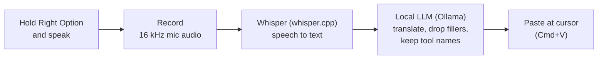

# Voice Prompt

Hold a key, speak Hebrew (or English, or both mixed), release. A clean **English prompt** is pasted wherever your cursor is: Claude, a terminal, a chat box. It runs on your Mac. No cloud service is needed.

I built it because I think in Hebrew but write prompts in English, with tool names like `kubectl`, `ArgoCD` and `Trident` in the middle of Hebrew sentences. Speech-to-text alone mangles those, and plain Whisper "translate" drops them.

## How it works



Two steps on purpose: Whisper only transcribes, then an LLM rewrites. That way a lost word can be traced to one stage or the other (see [Evaluation](#evaluation)).

## Modes

Pick one from the menubar icon (🎙 → Mode). The choice is remembered.

| Mode | Speech to text | Text cleanup | Typical wait\* |
|---|---|---|---|
| **Hebrew + English** | Whisper large-v3-turbo, forced to Hebrew | Gemma 3 12B translates and tidies | ~8 to 15 s |
| **Hebrew + English (faster)** | same | Qwen 2.5 7B: about 3x faster, similar quality on 4 clips | ~3 to 6 s |
| **English only** (default for English) | same model, forced to English | none: a glossary of find-and-replace rules (`prompts/glossary-en.json`) | ~2 s |
| **English + AI rewrite** (experimental) | same | Qwen 2.5 7B rewrites | ~3 s |

Why English has no LLM by default: Whisper already adds punctuation and drops most "um"s, and on real dictations the rewrite step lost content (once 27 words became 4). A glossary can fix tool names (`cube control` becomes `kubectl`) but cannot delete a sentence. Hebrew needs the LLM, because it has to translate.

\*Measured on an M1 MacBook Pro with a handful of short clips, not a benchmark. Run `src/stats.py` for your own numbers.

### Spoken editing in English-only mode
With no LLM there is no judgement, so a few fixed phrases edit your dictation. Say them as their own sentence (Whisper's punctuation marks the edges):

| Say | Effect |
|---|---|
| "Scratch that." (also strike / delete / erase / forget / cancel that) | removes the previous sentence |
| "Start over." / "Delete everything and start from here." | removes everything before it |
| "No, never mind. Scratch that." | same; the "no / never mind / wait / sorry" lead-in is part of the command |

Phrases used as ordinary words ("we should delete that file", "delete everything in the namespace") are left alone, because a command must be a sentence of its own. If Whisper doesn't punctuate around it, nothing happens (it fails safe). Turn off with `"voice_commands": false` on the `glossary` entry in `eval/setups.json`. Tests: `python3 -m unittest discover -s tests`.

## Controls

| Action | Result |
|---|---|
| Hold **Right Option**, release | Record, then transcribe, rewrite and paste |
| **Esc** while holding | Discard the recording |
| **Double-tap** Right Option while it is working | Cancel, nothing is pasted |
| 🎙 icon → Cancel | Same as either of the above |

Icon: 🎙 idle, 🔴 recording, ⏳ working. There is also a "Start at login" toggle.

## Setup (macOS, Apple Silicon)

**One command** (installs only what is missing, safe to re-run):

```bash
scripts/install.sh --check   # look first, change nothing
scripts/install.sh           # then fix whatever is missing and build the app
```

It needs [Homebrew](https://brew.sh). Below is what it does, if you prefer to do it by hand:

```bash
brew install whisper.cpp portaudio ollama
ollama pull gemma3:12b && ollama pull qwen2.5:7b

# Whisper model (ggml format) into ~/models/whisper/
mkdir -p ~/models/whisper && curl -L -o ~/models/whisper/ggml-large-v3-turbo.bin \
  https://huggingface.co/ggerganov/whisper.cpp/resolve/main/ggml-large-v3-turbo.bin

python3 -m venv .venv
.venv/bin/pip install --upgrade pip
# pyobjc is pinned below 12: version 12 has no prebuilt wheel for Python 3.9 and fails to compile
.venv/bin/pip install "pyobjc-core<12" "pyobjc-framework-Cocoa<12" "pyobjc-framework-Quartz<12" \
  "pyobjc-framework-ApplicationServices<12" "pyobjc-framework-CoreText<12" \
  sounddevice pynput numpy rumps py2app

.venv/bin/python setup.py py2app -A   # builds dist/"Voice Prompt.app" (runs from this folder)
open "dist/Voice Prompt.app"
```

**Permissions.** macOS treats the app as untrusted until you allow it. Under System Settings, Privacy & Security, add **Voice Prompt** to *Microphone*, *Accessibility* and *Input Monitoring*, then quit and reopen it. Without Accessibility the text is not pasted, but it is still on your clipboard. The menu shows a warning when this is the problem.

Prefer a terminal? `.venv/bin/python src/app.py --mode english` does the same thing. Add `--wav file.wav` to test without a microphone.

## Logs

Two files in `~/Library/Logs/VoicePrompt/` (outside the repo, never committed):

| File | Contains | Spoken text? |
|---|---|---|
| `dictations.jsonl` | audio length, time per step, outcome | no |
| `transcripts.jsonl` | what Whisper heard and what the LLM produced | **yes** |

```bash
.venv/bin/python src/stats.py --last 20         # median / p90 / max timings per mode
.venv/bin/python src/transcripts.py --last 5    # Whisper text next to the LLM output
```

Don't want your words stored? Set `"log_text": false` in `~/Library/Application Support/VoicePrompt/config.json`.

## Resource use

```bash
scripts/resources.sh            # one snapshot: CPU and memory of the app, Whisper and Ollama
scripts/resources.sh --watch    # live; start it, then dictate to see Whisper appear for ~2 s
```

On an M1 with 32 GB, measured: the menubar app idles at ~120 MB and ~2 % CPU; Whisper peaks at ~1.9 GB for ~2 s per dictation; the LLM is the big one (Gemma ~8 GB, Qwen ~5.7 GB of GPU-shared memory) and only exists in the LLM modes. The app unloads an LLM when you switch away from it or quit, and Ollama frees idle models after 10 minutes. Activity Monitor works too: search "Voice Prompt", "ollama" and "whisper"; Window → GPU History (Cmd+4) shows the GPU.

## Evaluation

`eval/run_eval.py` runs each Whisper setup (turbo, large-v3, ivrit-ai Hebrew fine-tune; forced `he` vs auto) over recorded clips and scores whether English terms survive. The recordings stay private, so results cannot be reproduced from this repo, but the harness and the prompts are here (`prompts/`, versioned; v4-en is used by the experimental AI-rewrite mode, v5-en is a restructured variant that scored worse).

**Prompt test set.** `eval/prompt_cases.json` has 32 text-only cases (fillers, misheard tool names, spoken commands, self-corrections, injection attempts, long requests) that need no audio:

```bash
python3 eval/run_eval.py prompts --prompt prompts/v4-en.md --llm llama3 gemma -v
```

First finding on 4 mixed clips: no clear speech-model winner. Most "lost" tool names came out as Hebrew spellings (`אוסי` for `oc`), which the LLM step fixes using a glossary in the prompt. That glossary was tuned on those same 4 clips, so treat it as unproven until it is tested on new recordings. See [RESULTS.md](RESULTS.md).

## Layout

```
src/core.py       hotkey state machine: record, transcribe, rewrite, paste, cancel
src/backends.py   whisper.cpp / Ollama / Anthropic calls (shared with the eval)
scripts/install.sh  one-command setup and check
src/menubar.py    the menubar app        src/app.py   terminal version
scripts/resources.sh  CPU / memory snapshot
src/metrics.py    logs        src/stats.py   timings        src/transcripts.py   heard vs output
prompts/          system prompts, versioned      eval/   harness and setups
```

## Limitations

- Personal project: tested on one Mac. Hebrew mode is noticeably slower than the ~0.5x-of-speech-time goal.
- Whisper can invent text on silence, so very quiet or very short clips are skipped.
- A mid-sentence self-correction in Hebrew is only partly handled.
- The app needs whisper.cpp and Ollama installed. It does not bundle them.
